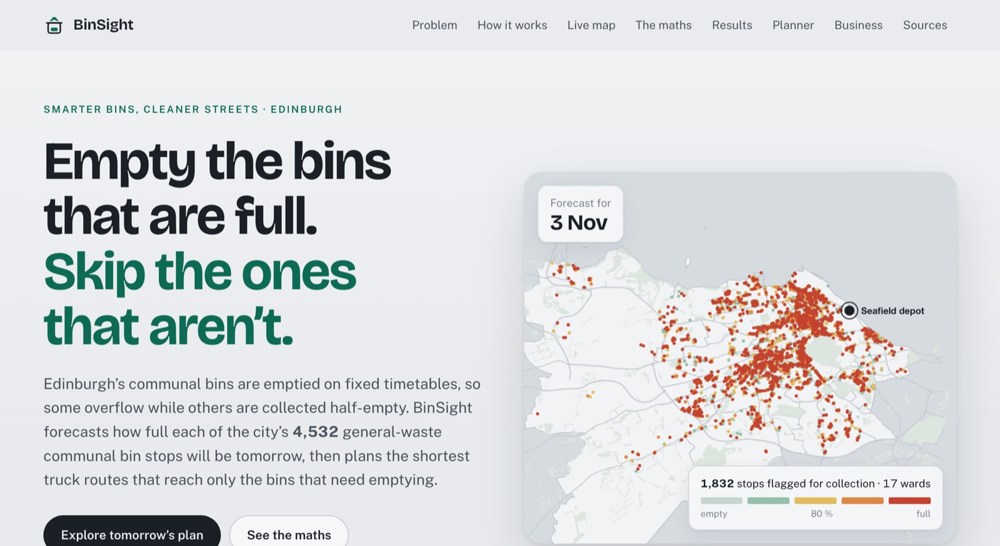
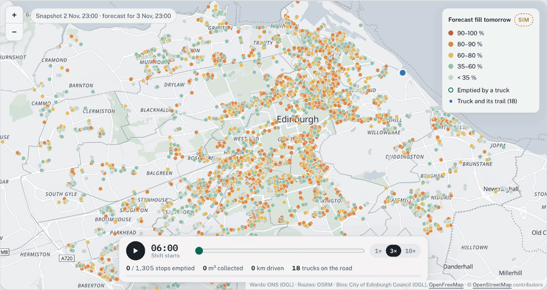
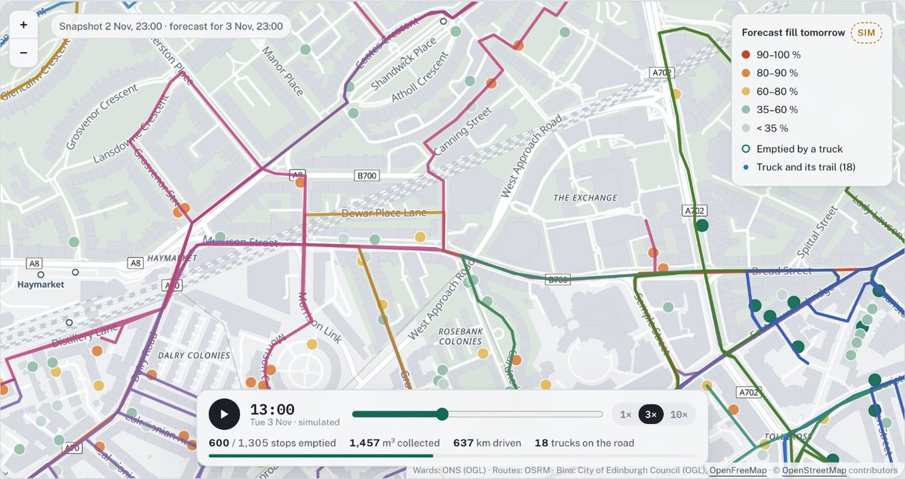

# BinSight Edinburgh

**Empty the bins that are full. Skip the ones that aren’t.**

<p align="center">
  <a href="https://pasbean61.github.io/binsight-edinburgh/"></a>
</p>

<p align="center">
  <a href="https://pasbean61.github.io/binsight-edinburgh/"></a>
</p>

<p align="center"><b><a href="https://pasbean61.github.io/binsight-edinburgh/">pasbean61.github.io/binsight-edinburgh</a></b> · click the picture or the button to open the site</p>

### Tomorrow’s shift, replayed

18 trucks leave Seafield at 06:00 and drive real Edinburgh streets to the 1,305 bins forecast to need emptying. The last one is back at 01:50 the next morning. [Watch it live on the site →](https://pasbean61.github.io/binsight-edinburgh/#console)

<p align="center">
  <a href="https://pasbean61.github.io/binsight-edinburgh/#console"></a>
</p>

### Zoom to street level

The map is a real street map of Edinburgh. Zoom in to see every building, street name and house number, with each truck’s route in its own colour (here: Haymarket, the West End and Dalry).

<p align="center">
  <a href="https://pasbean61.github.io/binsight-edinburgh/#console"></a>
</p>

## About

BinSight forecasts how full each of Edinburgh’s general-waste communal bins will be tomorrow and plans the shortest truck routes that reach only the bins that need emptying. This repository holds the public website and the model behind it, written from scratch by the team: a stochastic fill model, a probabilistic forecast, a chance-constrained decision rule, a routing heuristic, and checks against exact optima. The maths is explained on the site and in [`model/README.md`](model/README.md).

A project by **EMS Group 6, University of Edinburgh**.

## The website

One page, in this order:

| Section | What you can do |
|---|---|
| **Problem** | Edinburgh’s communal-bin problem in sourced numbers, plus an interactive “timetable vs BinSight” fortnight |
| **How it works** | Sense → Predict → Optimise → Collect, with the real formulas and methods |
| **Live map** | A real street map of Edinburgh you can zoom from the whole city down to single buildings and house numbers, with all 4,533 real stops in their real wards, plus a replay of tomorrow’s shift: 18 trucks leave Seafield at 06:00, drive their routes on real streets and empty each flagged bin while trails, counters and the clock run. Follow any truck, hover and open wards, search streets, switch to overflow risk or the council’s full 17,713-asset register; driver view, alerts, sensor health and real weather below the map |
| **Results** | Four collection strategies over a 7-day × 2-seed replay, forecast accuracy, ablation and weight sensitivity, and a shift-time reality check |
| **Planner** | Change the threshold, fleet, shift and lift time; distance is estimated with the Beardwood–Halton–Hammersley law calibrated to the optimised plan |
| **Business** | Three-partner model, revenue models A–G, gain-share calculator, go-to-market, evidence and risks |
| **Sources** | What is real, simulated or assumed, and every reference |
| **AI twin** | A chat rail that answers from the site’s data, ranks wards and streets, runs what-if scenarios and moves the map |

### The AI twin

The twin has two engines:

1. **Built-in engine** (always on, including GitHub Pages): intent rules over the live data (streets, stop IDs, wards, trucks, rankings, counts, what-if plans, gain-share, weather, model accuracy) plus a ranked knowledge base of 45 entries written from the business plan and the engine.
2. **Claude** (when the page is opened as a Claude artifact): the same data and knowledge base go to Claude, which can call page tools (`search_stops`, `rank_streets`, `truck_route`, `what_if`, `gain_share`, `show_on_map`) and streams its answer.

Open the browser console and run `__twinTest("your question")` to test the built-in engine.

## What is real

| Data | Status | Source |
|---|---|---|
| Bin locations, sizes, counts, street descriptions | Real | City of Edinburgh Council *Communal Bins* register (17,713 records, OGL v3.0) |
| Ward of every stop | Real | ONS Wards (December 2024) boundaries, point-in-polygon |
| Street map: buildings, street names, house numbers, stations, parks | Real | OpenStreetMap vector tiles from [OpenFreeMap](https://openfreemap.org), drawn with MapLibre GL (a light Overpass-based map is the offline fallback) |
| Road network, distances, times, route geometry | Real streets | OpenStreetMap via Overpass (ODbL), our Dijkstra shortest paths |
| Hourly temperature and rain (4 Oct – 3 Nov 2026) | Real | Open-Meteo |
| Problem, market and policy statistics | Real, cited | See the Sources section |
| Fill levels, collections, sensor battery and signal | **Simulated** | The council does not publish its sensor feed |
| Fleet and costs (24 trucks × 60 m³, 8-hour shift, 2 min a stop + 1 min a bin, £1.45/km, £75/truck-hour, £60 per overflow) | Assumed | `model/config.py` |

## Repository layout

```
index.html                  the website (GitHub Pages), built from src/
src/                        page source: body.html, style.css, app.js, maths.js, twin.js
data/                       site data written by the model
model/                      the BinSight model (Python: numpy, scipy, pyproj)
  network.py                real stops, wards and the OpenStreetMap road graph
  simulate.py               compound-Poisson fill simulator
  forecast.py               probabilistic forecast
  decide.py                 chance-constrained, capacity-priced decision rule
  route.py                  Clarke–Wright, local search, simulated annealing, shift packing
  exact.py                  exact MILP (HiGHS) and lower bounds
  experiment.py             rolling-horizon experiment with common random numbers
  export.py, run.py         site data and the entry point
scripts/build_page.py       src/ → index.html and site/binsight.html
docs/                       README images
```

## Rebuild everything

```bash
pip install numpy scipy pyproj
python -m model.run --experiments   # about 25 minutes on 10 cores; omit the flag to reuse cached experiments
python scripts/build_page.py
```

The road network (`model/data/cache/osm_roads.json`) and its distance matrix are cached and not committed; see `model/README.md` to fetch them.

## Acknowledgement

The team’s first prototype built on the open-source [EcoBin](https://github.com/RishvinReddy/EcoBin-Smart-Waste-Management-System) project by Rishvin Reddy (MIT licence). We thank its author. None of its code is used now: the model in `model/` is our own.

## Licences and attribution

- Code: MIT (see `LICENSE`).
- Bin data: City of Edinburgh Council, *Communal Bins*, Open Government Licence v3.0. Contains OS data © Crown copyright and database right 2026.
- Ward boundaries: Office for National Statistics, Open Government Licence v3.0.
- Map data: © OpenStreetMap contributors, ODbL. Map tiles: OpenFreeMap. Rendering: MapLibre GL JS (BSD-3) with maplibre-gl-leaflet.
- Weather: Open-Meteo, CC BY 4.0.
